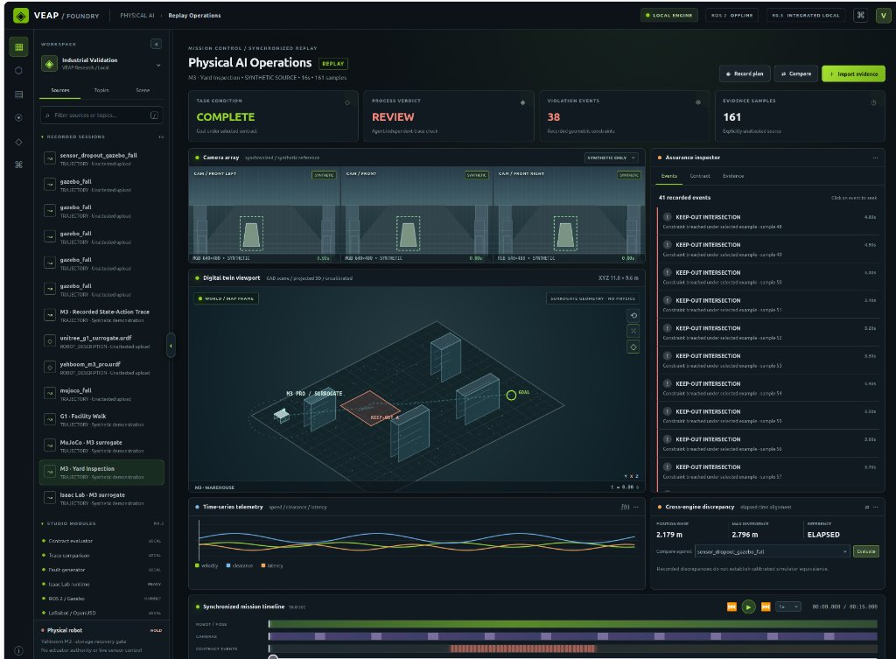
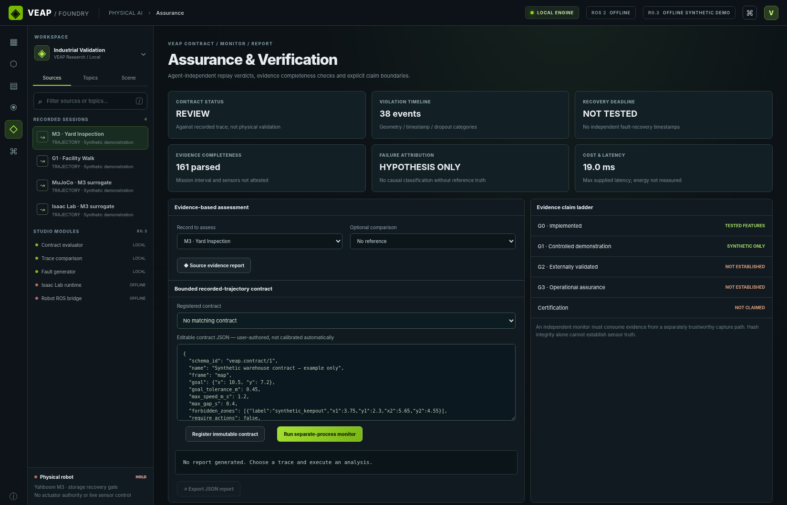
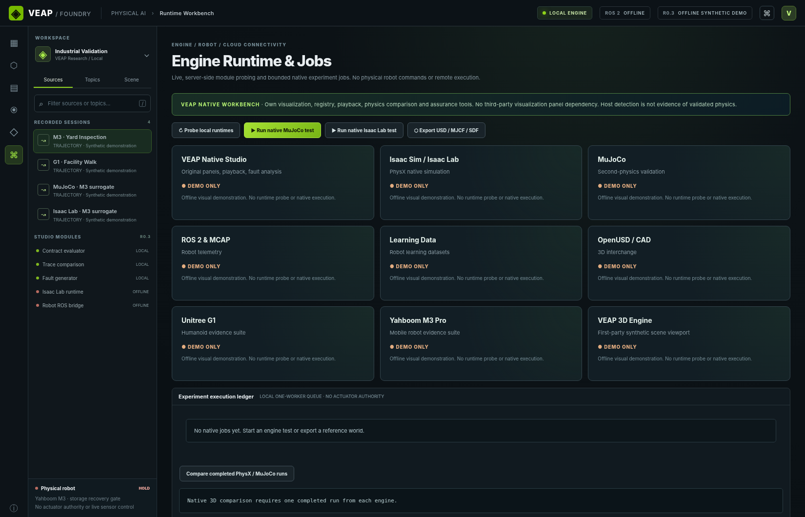

# VEAP — Verifiable Embodied Agent Platform

[](#continuous-verification--governance)
[](#tools--framework-architecture)
[](#tools--framework-architecture)
[](#tools--framework-architecture)
[](#tools--framework-architecture)

**An evidence-first evaluation, cross-simulator replay, and runtime assurance platform for autonomous and embodied AI.**

> **Core Definition:** VEAP is a **model- and harness-agnostic evaluation protocol** that jointly measures **task success**, **constraint violations**, **recovery**, **resource cost**, and **independently checkable evidence** under **controlled faults**.

> **Evidence & Claim Boundaries:** Components carry explicit maturity labels (`Core v0.1.0`, `Evidence R1.1–R1.3`, `Studio R0.3 / VEAP Foundry`, `M3 Replay R0.1`, and `v0.6 Native Cross-Engine Acceptance`). **No production readiness, SOTA superiority, independently attested hardware ground truth, or physical safety certification is claimed.**

---

## Tools & Framework Architecture

| Layer | Technologies & Frameworks | Role in VEAP | Evidence Boundary |
|---|---|---|---|
| **Core Benchmark & Safety Gate** | `Python 3.10+`, `Pydantic v2`, `FastAPI`, `Uvicorn`, `SQLite` | Deterministic scenario contracts (`veap-scenario/1`), greedy & A\* route planners, geometric safety gate, SHA-256 hash-linked event ledger | `veap/` (`v0.1.0`, deterministic 2-D kinematic benchmark) |
| **Native Physics & 3-D Scene Pipeline** | `MuJoCo 4.0.1`, `NVIDIA Isaac Lab 0.54.3` / `Isaac Sim 5.1.0.0` (`PhysX`, `CUDA`), `OpenUSD (.usda)`, `MJCF (.xml)`, `URDF`, `SDF 1.10`, `glTF 2.0 (.glb)` | Locked open-loop command-tape replay (`veab-control-tape/1`), `ENU_z_up_m` scene compilation, `ContactSensor` instrumentation, 40-trace held-out gate | `veap/simulation/` (`v0.6`, uncalibrated planar surrogate; `eligible_for_physics_equivalence_claim = false`) |
| **Assurance Studio / VEAP Foundry** | `VEAP Studio R0.3`, `FastAPI`, `Vanilla JS / Canvas`, `OIDC` (`VEAP_OIDC_*`) | Read-only multi-tenant replay, assurance & contract monitor, native runtime workbench, evidence claim ladder (`G0–G3`) | `veap_studio_r03/`, `veap/enterprise/` (local evaluation; live IdP auth unverified) |
| **Cryptographic Custody & Verification** | `Ed25519` (`R1.3`), `HMAC-SHA256`, `Rust` (`backend/rust_verifier`), `Go` (`veap-go-orchestrator`) | Independent trace verification, three-valued evidence certificates, public-key reference custody | `veap_evidence_r1_1/`, `backend/` (software-tested custody; synthetic R1.1/R1.2 certificates) |
| **Robotics & Telemetry Ingest** | `ROS 2 Humble` (`rosbag2`), `MCAP` (`mcap_decode.py`), `JSONL` | Read-only external trajectory and bag metadata ingest with explicit untrusted-provenance labelling | `veap/m3_replay/` (`R0.1`, synthetic metadata contract; physical sensor gates open) |
| **Governance & CI/CD** | `GitHub Actions`, `Pytest`, `docs/CLAIMS_REGISTER.json`, `scripts/check_claims.py` | Continuous verification, scientific software gate, SHA-256 claims audit, native MuJoCo candidate gate | `.github/workflows/` |

---

## Visual Surfaces: VEAP Foundry

### 1. Physical AI Replay Operations
Multi-camera synchronized replay, 3-D digital twin viewport (`M3-WAREHOUSE` / `KEEP-OUT`), Assurance Inspector (`41 recorded events`), time-series telemetry, cross-engine discrepancy panel, and synchronized mission timeline.



### 2. VEAP Foundry / Studio R0.3 (`veap_studio_r03/`)
Enterprise & research assurance workbench featuring the **Evidence Claim Ladder (`G0–G3`)**, separate-process contract monitor, and native simulator runtime status.

| Assurance & Evidence Claim Ladder | Native Runtime Workbench |
|---|---|
|  |  |

---

## Canonical Research Narrative: From Apparent Success to Verifiable Autonomy

VEAP evaluates process-level verification through empirical evidence rather than outcome-only pass rates. In the bundled 60-trial factorial evaluation (`5` scenarios × `3` seeds × `2` policies × `2` safety-gate settings):

| Configuration | Task completion | Verified completion | Safety violations |
|---|---|---|---|
| **Greedy, gate off** | `12/15` | `3/15` | `147` |
| **Greedy, gate on** | `12/15` | `12/15` | `0` |
| **Route, gate off** | `15/15` | `15/15` | `0` |
| **Route, gate on** | `15/15` | `15/15` | `0` |

> **Key Finding:** **Nine of fifteen ungated greedy trials reached their task objectives but were rejected by the independent verifier because they violated safety constraints.**

For example, in `warehouse-transfer` (`seed = 0`), the unshielded greedy planner reaches the goal with `22` geometric violations in `68` steps (scored as `100%` success by an outcome-only evaluator). Enabling the geometric safety gate yields `22` safety interventions, `0` violations, and `83` steps. See [docs/CANONICAL_NARRATIVE.md](docs/CANONICAL_NARRATIVE.md).

---

## v0.6 Native Cross-Engine Physics Acceptance (`MuJoCo` × `Isaac Lab`)

Executed on an **NVIDIA RTX 4080 SUPER** workstation (`MuJoCo 4.0.1` and `Isaac Lab 0.54.3 / Isaac Sim 5.1.0.0`) using frozen open-loop command tapes (`veab-control-tape/1`):

| Stage | Scope & Artifact | Verified Outcome |
|---|---|---|
| **1. Pilot Localization** | [`v06-pilot-per-tick-diagnostic.json`](artifacts/research/v06-pilot-per-tick-diagnostic.json) | Confirmed `0.20182817 m` pilot RMSE repeats with `0.0 m` drift; localized to tick-0 gravity drop (`z = 0.16 → 0.135 m`) + PhysX Coulomb static-friction stall (`ticks 2–18`) and `25/25` missing right contacts. |
| **2. Model Alignment & Contacts** | [`isaaclab_native_runner.py`](veap/simulation/isaaclab_native_runner.py), [`v06-stage2-contact-verification.json`](artifacts/research/v06-stage2-contact-verification.json) | Aligned `ENU_z_up_m` frames, explicit `WXYZ → XYZW` quaternions, `s⁻¹` damping, and `ContactSensor` instrumentation distinguishing `0`, `> 0`, and `null` (never coerced to `0`). |
| **3. Frozen Manifest** | [`v06-evaluation-manifest.json`](artifacts/research/v06-evaluation-manifest.json) | Froze criteria (`max_position_rmse_m <= 0.100 m`, `P90 <= 0.150 m`, `max <= 0.200 m`, `timegrid <= 1e-6 s`, `0` missing contacts), scene/asset hashes, preserved `0.20182817 m` pilot, and `20` `test`-split tapes across `3` task families. |
| **4. 40-Trace Release Gate** | [`v06-release-gate-report.json`](artifacts/research/v06-release-gate-report.json), [`v06-heldout-traces/`](artifacts/research/v06-heldout-traces/) | **40 native traces** (`372` samples): `mean_rmse = 0.0135539 m`, `max_rmse = 0.06157238 m`, `max_error = 0.08551475 m`, `timegrid_err = 0.0 s`, `0` missing contacts. `18/20` passed; `insp-07` & `insp-08` honestly flagged (`0.0769` binary contact-state disagreement from a 1-tick PhysX contact-offset lead). |

See [README_V06.md](README_V06.md) and [docs/release/V06_NATIVE_ACCEPTANCE_PROTOCOL.md](docs/release/V06_NATIVE_ACCEPTANCE_PROTOCOL.md).

---

## Quick Start — Linux, macOS, or Windows (Python 3.10+)

```bash
git clone https://github.com/FAVL-AI/VEAP.git
cd VEAP
python -m venv .venv
source .venv/bin/activate             # Windows PowerShell: .venv\Scripts\Activate.ps1
python -m pip install -e '.[test]'
python -m pytest -q
python -m uvicorn veap.api:app --host 127.0.0.1 --port 8000
```

Open **http://127.0.0.1:8000** to launch the **VEAP Agent Observatory**. Select a scenario contract, choose a baseline (`route` or `greedy`), toggle the geometric safety gate, and run the benchmark. Exported evidence JSON bundles are independently verifiable via `python -m veap verify <bundle.json>`.

---

## Command-Line Experiments & Native Replay

```bash
# Discover task contracts and split labels
python -m veap scenarios

# Execute an auditable simulation trial with seed 17
python -m veap run --scenario warehouse-transfer --policy route --seed 17 --out artifacts/warehouse.json

# Independently verify a standalone evidence bundle
python -m veap verify artifacts/warehouse.json

# Run the 60-trial factorial ablation suite
python -m veap suite --seeds 0 1 2 --split all --out artifacts/suite-summary.json

# v0.6 native MuJoCo replay & 40-trace gate evaluation
python scripts/veap_v06.py run-mujoco --tape artifacts/research/v06-control-tape.json --out artifacts/v06/mujoco
python scripts/veap_v06.py evaluate-gate \
  --manifest artifacts/research/v06-evaluation-manifest.json \
  --traces-dir artifacts/research/v06-heldout-traces \
  --out artifacts/research/v06-release-gate-report.json
```

---

## Continuous Verification & Governance

- **Claims governance:** Every registered claim in [`docs/CLAIMS_REGISTER.json`](docs/CLAIMS_REGISTER.json) is SHA-256 bound to its source artifact and validated by `python scripts/check_claims.py`.
- **Security boundary:** The default API binds `127.0.0.1` without authentication for local use only. Never expose it on an untrusted network without TLS, authentication (`VEAP_ADMIN_TOKEN` / `VEAP_OIDC_*`), and network isolation. See [`docs/THREAT_MODEL.md`](docs/THREAT_MODEL.md).

## Repository Layout

```text
veap/                    Core spec, planners, simulator, ledger, verifier, M3 replay, native runners & v0.6 gate
veap_evidence_r1_1/      R1.1–R1.3 three-valued evidence & Ed25519 public-key custody extension
veap_studio_r03/         VEAP Foundry / Studio R0.3 multi-tenant UI, monitors, and offline demo
backend/                 Rust standalone verifier & Go orchestrator
scenarios/               Versioned public train / validation / test task contracts
web/                     VEAP Agent Observatory (vanilla JS + isometric 3-D projection)
artifacts/research/      Frozen v0.6 pilot, diagnostic, manifest, 40 native traces & gate report
tests/                   Pytest unit, API, claims, studio, and native MuJoCo integration suites
docs/                    Protocols, threat model, claims policy, release train, and screenshots
```

## Peer-Reviewed Foundations & Technical References

1. Zhou, S. et al. (2024). **WebArena: A Realistic Web Environment for Building Autonomous Agents.** ICLR 2024. https://proceedings.iclr.cc/paper_files/paper/2024/hash/4410c0711e9154a7a2d26f9b3816d1ef-Abstract-Conference.html
2. Zhu, Y. et al. (2025). **Establishing Best Practices in Building Rigorous Agentic Benchmarks.** NeurIPS 2025, Datasets and Benchmarks. DOI: **10.52202/085713-5547**. https://proceedings.neurips.cc/paper_files/paper/2025/hash/f316275b44ee2de533102913828a8107-Abstract-Datasets_and_Benchmarks_Track.html
3. Xie, T. et al. (2024). **OSWorld: Benchmarking Multimodal Agents for Open-Ended Tasks in Real Computer Environments.** NeurIPS 2024. https://os-world.github.io/
4. NVIDIA Isaac Lab Direct Workflow & Sensor Documentation: https://isaac-sim.github.io/IsaacLab/develop/source/tutorials/03_envs/create_direct_rl_env.html
5. MuJoCo Python API Documentation: https://mujoco.readthedocs.io/en/stable/python.html
6. ROS 2 `rosbag2` & MCAP Recording Specification: https://github.com/ros2/rosbag2 · https://mcap.dev/guides/getting-started/ros-2
