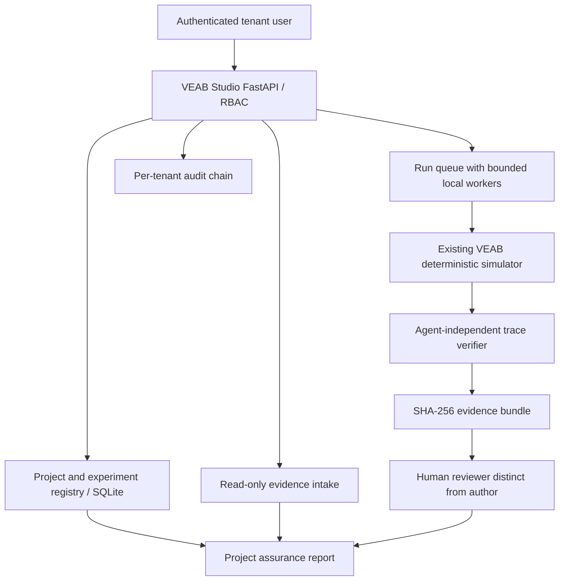

# VEAB Assurance Studio — architecture and traceability

## Scope

Scientific programme: open benchmark contracts, repeatable simulations, external-reference experiments, matched comparisons, independent assurance research.

Commercial programme: customer evidence ingestion, tenant isolation, managed trials, review workflows, auditable project reports, controlled access.

These programmes share data contracts while maintaining independent scientific claims and customer security boundaries. No external data is used for benchmark training. The v0.5 service is a **single-node pilot**.

### Trust boundaries

- **Identity:** verified bearer access, tenant selection derived from authenticated membership. Never accept user-selected tenant as proof of access.
- **Execution:** existing internal simulator is used only for benchmark trials. It is not trusted external hardware ground truth. It has no production robot control endpoint.
- **Evidence:** uploaded ROS-related files are stored as untrusted source material. SHA-256 demonstrates stored-file consistency, not independent sensor authenticity.
- **Human evaluation:** reviewer and run creator differ. An adjudication workflow must later add blindness, calibrated annotations and inter-rater agreement.
- **Audit:** every mutation appends a canonical hash-linked tenant event. Deletion/truncation and full ledger rewriting require external anchors in R2/R4.
- **Simulator adapters:** `.usda` / `.xml` / `.sdf` / `.urdf` / `.glb` exports exist. Native physics, sensor calibration and Gazebo/Isaac runtime measurements remain separately gated.

### Model/harness-agnostic evaluation contract (next version)

`RunContract = {task_hash, scene_hash, policy_id, model_id, harness_digest, safety_gate_digest, simulator_digest, rng_seed, faults, wall_clock, trace_sha256, reference_labels, resource_metrics, verifier_version}`.

Not all fields have reliable measurements in v0.5; missing fields must be declared `unmeasured`, not silently set to zero. Each future simulator adapter must implement a compatible observation, action and telemetry schema, with coordinate-frame and timestamp conformance tests.

### Production target split

Control plane: OIDC + PostgreSQL + tenant access policies + tenant-approved object storage + stable API.

Data plane: isolated, resource-bounded simulator workers with remote attestation where feasible; dedicated GPU nodes for Isaac Lab; read-only ROS 2/MCAP adapters.

Assurance plane: independent monitor process and human adjudication; external time-stamped evidence anchors, per-artifact signatures, and calibrated real-world reference instrumentation.

These are targets, not delivered capabilities of v0.5.
